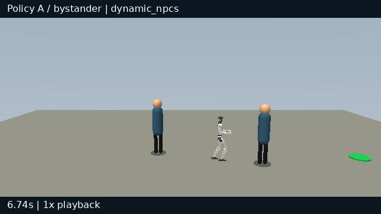
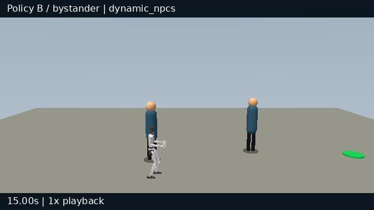

# AsimovBM

**How do we evaluate robots? What makes one robot better than another, and by
what criteria should we judge them?**

As robots increasingly operate alongside people, evaluating their performance
requires looking beyond task completion and traditional engineering metrics.
AsimovBM aims to lay the foundations for a common benchmark for mobile robots
in human-centered environments, helping researchers, companies and end users
understand which robots perform better, in which areas, and why.

The framework defines sixteen interpretable behavioral features and combines
available telemetry into four human-facing scores: **Perceived Dexterity**,
**Perceived Safety**, **Perceived Social Awareness**, and **Impression**.
Explicit thresholds and literature-informed weights make each score traceable
to the robot's behavior. A preliminary study with two Unitree G1 policies and
120 participants found significant human differences in dexterity and overall
impression, with the uncalibrated benchmark favoring the same policy on both.

[Workshop paper](https://openreview.net/forum?id=UNy8Z0IlrK) ·
[Paper PDF](paper/AsimovBM_ICRA2026.pdf) ·
[Reproduction guide](paper/README.md) ·
[Implementation notes](paper/IMPLEMENTATION_NOTES.md)

## Paper

**AsimovBM: Toward Automatic Evaluation of Human-Perceived Traits in Physical AI Robots**

Andrea Tosi, Nicolò Dellepiane, Luis Sebastian Caballero Fritas, Tommaso Felice Banfi

*ICRA 2026 Workshop on Bridging the Gap between Robot Learning and Human-Robot Interaction* — poster.

The repository contains the paper, anonymous survey responses, twelve archived
simulation runs, analysis scripts, and the local benchmark implementation.
The short [implementation notes](paper/IMPLEMENTATION_NOTES.md) explain the
navigation approximations and how to interpret the reported comparisons.

## Watch the episodes

Click a preview to open its MP4. These videos replay the archived robot motion;
the source mapping and rendering settings are recorded in the
[video manifest](artifacts/reconstructed-videos/manifest.json).

**Policy A — moving pedestrians, bystander view**

[](artifacts/reconstructed-videos/q3/g1_point_to_point_dynamic_npcs.mp4)

**Policy B — moving pedestrians, bystander view**

[](artifacts/reconstructed-videos/q4/g1_point_to_point_dynamic_npcs.mp4)

All **12 episode clips and four compilations** are in
[`artifacts/reconstructed-videos/`](artifacts/reconstructed-videos/).
After cloning, open its `index.html` in a browser for the complete gallery.
[Six recovered historical videos](artifacts/historical-videos/) are available
separately with their source commit and checksums.

## Get started

Use Python **3.11 or newer**. Run these commands from the repository root:

```bash
git clone https://github.com/NicoDelle/asimovbm.git
cd asimovbm
python3 -m venv .venv
.venv/bin/python -m pip install -e '.[dev,paper]'
```

### Reproduce the paper analysis

The notebook reads the released survey responses and archived simulation
results. It does not require running MuJoCo or downloading policy weights.

```bash
.venv/bin/jupyter nbconvert --to notebook --execute \
  paper/analysis/paper_results.ipynb \
  --output /tmp/asimovbm-paper-results.ipynb \
  --ExecutePreprocessor.timeout=600
```

See the [paper guide](paper/README.md) for figure-generation commands and the
[published result tables](paper/results/).

### Try the local benchmark

This portable reference example exercises navigation and metric reporting:

```bash
.venv/bin/asimovbm-local \
  --robot g1 \
  --trace-backend reference \
  --headless \
  --artifact-root artifacts/new-validation \
  --run-id quickstart
```

It writes a manifest, a report and episode metrics under
`artifacts/new-validation/quickstart/`. To run the learned G1 policies instead,
follow the [real-policy setup and examples](docs/paper-workflow.md#fresh-real-policy-runs).
To render the archived motion again, follow the
[video-generation instructions](paper/README.md#view-or-regenerate-episode-videos).

### Run tests

```bash
.venv/bin/python -m pytest
.venv/bin/python -m pytest g1_slam/tests/test_navigation.py
```

## Repository map

| Path | Contents |
|---|---|
| [`paper/`](paper/) | Paper, figures, survey data, analyses and result tables |
| [`paper/IMPLEMENTATION_NOTES.md`](paper/IMPLEMENTATION_NOTES.md) | Short explanation of experimental approximations |
| [`artifacts/local-validation/`](artifacts/local-validation/) | Twelve archived runs with traces and metrics |
| [`artifacts/reconstructed-videos/`](artifacts/reconstructed-videos/) | Episode videos, compilations and gallery |
| [`artifacts/historical-videos/`](artifacts/historical-videos/) | Recovered historical clips and provenance |
| [`asimovbm/`](asimovbm/) | Local runner, metrics, reports, survey and web app |
| [`g1_slam/`](g1_slam/) | Robot simulation package and episode configurations |
| [`metrics/README.md`](metrics/README.md) | Guide to the objective metric implementations |
| [`docs/paper-workflow.md`](docs/paper-workflow.md) | Detailed analysis and simulation workflow |
| [`tests/`](tests/) | Package and metric tests |

## Authors and contributors

Developed at [Talos Robotics AI](https://talosrobotics.ai/) by:

- [Andrea Tosi](https://github.com/andretosi)
- [Nicolò Dellepiane](https://github.com/NicoDelle)
- [Luis Sebastian Caballero Fritas](https://github.com/lcaballero10)
- [Tommaso Felice Banfi](https://github.com/BanfiTommasoFelice)

Simulation builds on [MuJoCo](https://github.com/google-deepmind/mujoco),
[RoboJuDo](https://github.com/HansZ8/RoboJuDo) and
[Unitree MuJoCo](https://github.com/unitreerobotics/unitree_mujoco).

## Citation

```bibtex
@inproceedings{tosi2026asimovbm,
  title={AsimovBM: Toward Automatic Evaluation of Human-Perceived Traits in Physical AI Robots},
  author={Tosi, Andrea and Dellepiane, Nicol{\`o} and Caballero Fritas, Luis Sebastian and Banfi, Tommaso Felice},
  booktitle={ICRA 2026 Workshop on Bridging the Gap between Robot Learning and Human-Robot Interaction},
  year={2026},
  url={https://openreview.net/forum?id=UNy8Z0IlrK}
}
```

Code is released under the [AGPL-3.0 license](LICENSE). Upstream simulation
packages retain their respective licenses.
